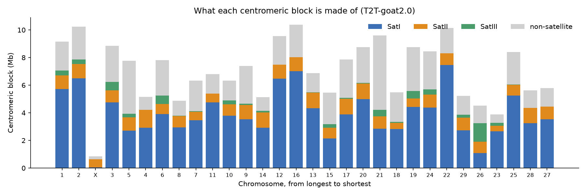
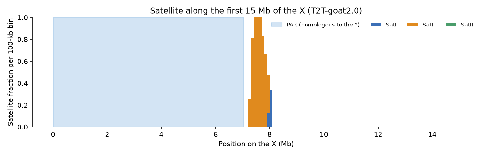
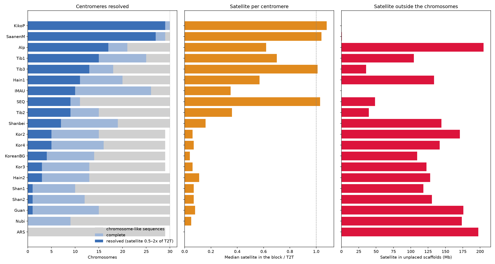
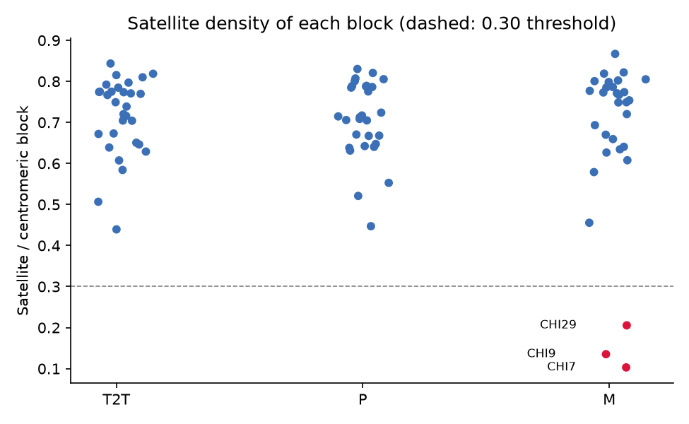
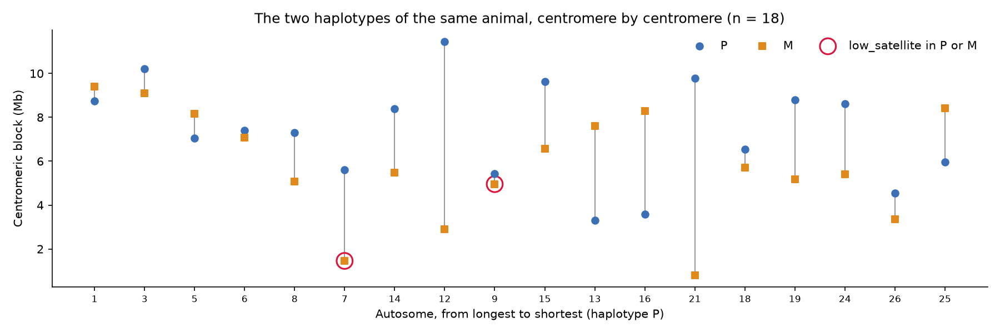
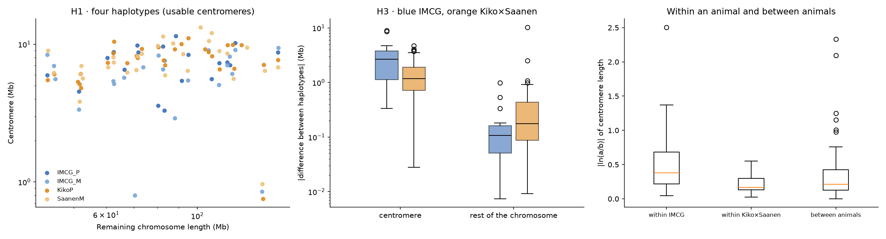
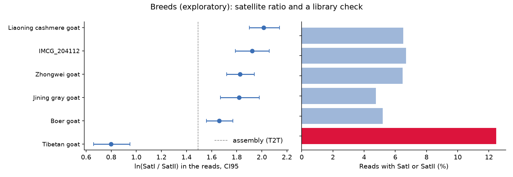

# Centromeric heterochromatin of *Capra hircus*
### A sequence-based case study with public data

I wanted to know how big goat centromeres are, whether they grow with the size of the chromosome, what they are made of, and how much the two haplotypes of one animal differ. I answer those questions with public data, going from the raw genome downloads all the way to the statistics.

I start from the public goat assemblies, of which NCBI holds 70. I use the telomere-to-telomere assembly T2T-goat2.0 (Wu et al. 2024) as my reference, because its authors resolved all the centromeres. Then I screened twenty other assemblies with the same method and kept only the ones whose centromeres are resolved well enough to be measured. Two animals made it: the animal of the reference assembly, with its two haplotypes, and a Kiko × Saanen F1 female, with two haplotypes of her own. My statistics use those four haplotypes.

> This is a personal portfolio and practice project. It is not peer reviewed and it is not a research article, so please read the [limitations](#limitations) before taking any number too seriously. I built it with the help of an AI coding assistant (Claude Code), and I reviewed the decisions and the results myself.


## At a glance

| | |
|---|---|
| Data | The T2T-goat2.0 assembly and its two haplotypes (2.0P, 2.0M), from a male Inner Mongolia Cashmere goat (`IMCG_204112`); 20 candidate assemblies from NCBI, of which a Kiko × Saanen F1 female (two haplotypes) is kept; PacBio reads of five breeds |
| Approach | Orient chromosomes, find satellite units (SRF), annotate, delimit each centromere, screen the candidates, run the statistics |
| Notebooks | `01` reference assembly, `02` screening of 20 assemblies, `03` statistics |
| Stack | Python (pandas, statsmodels, SciPy), minimap2, samtools, KMC, SRF |
| Runtime | notebook 01 about 20 min (about 5 GB of downloads), notebook 02 about 2 h (about 15 GB downloaded in total, deleted as it goes), notebook 03 a few minutes; on an Apple-silicon laptop |
| Main finding | The satellite blocks of the centromeres are large, differ a lot between haplotypes, and scale only weakly with chromosome size (a slope of about 0.3 in autosomes, not seen when the X is included) |

## What I asked

I ask three questions, which I call hypotheses. H1 asks whether centromere length scales with chromosome size. H2 asks whether the satellite composition (SatI, SatII and SatIII are the three satellite families) explains part of the variation. H3 asks whether the two homologs differ more in the centromere than in the rest of the chromosome. As a side question, I also look at whether satellite content varies between breeds.

## What I found

Every number comes from `data/results_summary.json` and the tables in `data/`.

Of my 20 candidate assemblies, only the two haplotypes of the Kiko × Saanen female have centromeres resolved about as well as the reference. In 29 and 27 of their 30 chromosomes the block has no gap, enough satellite, and between half and twice the satellite of the same chromosome in T2T-goat2.0. The best of the other assemblies resolve 17, 15 and 13. Most of them have between 35 and 205 Mb of satellite sitting in unplaced scaffolds, so their centromeres are fragmented rather than missing.

In T2T-goat2.0 the centromeric blocks go from 0.85 to 10.4 Mb, and the shortest is the X. SatI adds up to about 117 Mb and SatII to about 26 Mb, close to the totals in Wu et al. (118.2 and 26.5 Mb). I probably underestimate SatIII (about 6 Mb) because its short motif is hard to detect.

For H1, the slope of ln(centromere) on ln(remaining chromosome length) in the reference animal is −0.12 (95 % CI −0.80 to 0.57), and 0.19 (−0.10 to 0.47) without the X. With 80 % power that analysis can only detect a slope of at least 0.39 without the X, or 0.66 with it. In the four haplotypes, none shows scaling when the X is included (slopes between −0.06 and 0.19). In the autosomes the slope is about 0.3 in both animals (0.30 each and 0.30 pooled, 95 % CI 0.10 to 0.49), and the two animals do not differ from each other. So I read it as a weak scaling of about 0.3 in autosomes that the X flattens.

For H2, I find weak support. No satellite family scales with chromosome size. The SatI/SatII log-ratio adds 0.73 of R² to the scaling model in the reference animal, but only 0.25 without the X, and it is partly circular because it describes the same block.

For H3, the result is supported. In 18 autosomes of the reference animal with a complete centromere in both haplotypes, the median absolute difference is 2.7 Mb in the centromere and 0.11 Mb in the rest of the chromosome (permutation p ≈ 5×10⁻⁵), and SatI drives most of it. It holds on relative and absolute scales, without the outlier CHI21, with a strict gap criterion, and without the three blocks of haplotype M that have very little satellite (16 chromosomes, p ≈ 2×10⁻⁵). It also replicates in the Kiko × Saanen haplotypes, with a smaller effect: 1.17 Mb in the centromere against 0.18 Mb in the rest (p = 0.03 on the absolute scale, below 0.0001 on the relative one). Over the 44 pairs of both animals it is clear (1.28 against 0.14 Mb, p = 0.0001), but it depends on three chromosomes with large expansions of SatI that I discuss below.

Comparing within and between animals, in the 15 autosomes usable in all four haplotypes the median difference in centromere length, as |ln ratio|, is 0.38 between the two haplotypes of the reference animal, 0.17 between the two Kiko × Saanen haplotypes and 0.21 between animals. With 15 chromosomes this is a hint and not a result (p = 0.16).

For the breeds, which is exploratory, the SatI/SatII ratio is lower than in the reference animal in Tibetan (−1.12, CI −1.32 to −0.92) and in Boer (−0.26, CI −0.43 to −0.09), and not different in the other three. The Tibetan library looks atypical (see below), so I suspect a technical cause.

## How the analysis went

My original plan was to delimit the centromeres by combining CENP-A ChIP-seq, satellite density and sequence complexity, and then to compare chromosomes, haplotypes and animals. What follows is what happened when that plan met the public data, and several things changed along the way.

### 1. The genomes
NCBI holds 70 *Capra hircus* assemblies. Several are fragmented or built from short reads, and the satellite arrays of the centromeres are the hardest part of a genome to assemble. T2T-goat2.0 is the exception, since its authors resolved all the centromeres. It is the reference of the project, it provides the satellite units, and it comes with its two haplotypes (2.0P and 2.0M). I picked twenty other assemblies as candidates: mostly chromosome-level ones with a high contig N50, from several breeds and institutions, plus the RefSeq reference ARS1.2. I left out the other T2T-goat versions of the reference animal.

### 2. Getting the data
The three assemblies of the reference animal come from NCBI with MD5 checks, and I rename the chromosomes to `CHI1…CHI29, CHIX, CHIY`. In the maternal haplotype the X is called `30`, so I match it by length. The PacBio reads of the other breeds come from ENA, and I stream them and stop at 0.5 Gb per run, because the full files are 50 to 120 GB each. The pipeline first ran on Google Colab, where it ran out of memory in SRF and timed out on a base-level alignment. So I moved everything to my laptop and changed the annotation strategy (see step 4).

### 3. Orienting the chromosomes
Goat chromosomes are acrocentric, so each centromere should sit near one end. I first aligned the SatI reference sequence to both ends to see which one holds it, but that reference is short and diverged, and for most chromosomes it hits nothing, so on its own the test says very little. The real check comes after SRF. With the full set of satellite units, the centromere of every chromosome in the three assemblies of the reference animal (89 in total) sits at the left end of the deposited sequence, as the genome description says. In other assemblies the satellite can be at either end (in Kiko × Saanen it is at the left in 16 chromosomes and at the right in 14), so I check every assembly at both ends.

### 4. Finding and classifying the satellites
SRF counts frequent 151-mers and assembles them into repeat units, and it found 21 of them. I group them by sequence into SatI (an 816-bp monomer), SatII (702 bp) and SatIII (a 22-bp motif). My first version classified units by length only, and it counted units of 132, 770 and 2115 bp as SatII even though they are mostly repeats of the SatIII motif. Classifying by sequence brought the SatII total from about 33 Mb down to about 26 Mb, in line with the paper. Then I map the units back to each chromosome with minimap2, without base-level alignment, and give each 100-bp bin to its best hit.

### 5. What is a centromere here?
In this project a centromere is the satellite block with the most sequence in the proximal window, after merging pieces closer than 500 kb. It is an operational definition: it marks the satellite domain and not the CENP-A domain, so it can be longer than published values. I did try CENP-A ChIP-seq on a subsample of 2 million read pairs, and it showed no enrichment in any satellite family. Doing it per chromosome would need the full runs (about 29 GB) and unique mapping, because short reads inside nearly identical arrays cannot be assigned to a chromosome. I dropped it for that cost, not because it is impossible ([details](docs/NOTE_chipseq_removed.Rmd)).



Each block is mostly SatI, with SatII in every chromosome and SatIII in 24 of 30. Between about 15 and 55 % of each block is not satellite, because it includes the stretches between the pieces I merged.

### 6. The odd case of the X chromosome
The X has the shortest centromere, and its only satellite block lies 7.2 Mb from the end, while in the autosomes it starts at about 30 kb. I checked whether this was an error ([details](docs/X_CHROMOSOME_CHECK.md)) and it is not. The first 7 Mb of the X match the Y, which is the pseudoautosomal region that Wu et al. describe, they are rich in genes, SRF run on the X alone finds no new satellite, and the X of haplotype M lines up with it. The goat X is acrocentric, with a short arm of about 5 % of its length. It is real biology, but it is an influential point in H1 and H2.



### 7. Screening the 20 candidates
I processed every candidate with the same method as the reference, one at a time, deleting the big files after each. The result is the table in `data/screening/screen_summary.csv`. I match the chromosomes of each assembly to those of T2T-goat2.0 by aligning a segment from their middle, annotate the satellite at both ends of every chromosome, and annotate the unplaced scaffolds too, because satellite that did not make it into a chromosome would otherwise go unseen.



A high contig N50 does not mean that the centromeres are resolved, because satellite arrays are often collapsed or cut in long-read assemblies. My yardstick is T2T-goat2.0, so I count a block as resolved only if it is complete and its satellite is between half and twice that of the same chromosome there. A real expansion beyond twice would slip through. Only the two haplotypes of the Kiko × Saanen F1 female come close to the reference.

### 8. Blocks with very little satellite
In haplotype M of the reference animal, three centromeres (CHI7, CHI9 and CHI29) have between 10 and 21 % of satellite in the block, against at least 44 % in every other case.



In CHI7 and CHI29 the chromosome of M is shorter than in P and in T2T by roughly the missing amount, so sequence seems to be absent from the assembly. In CHI9 the sequence is there, but about 4 Mb of it does not match the SRF units, which I built from the collapsed assembly only. A density threshold is not a biological definition of a centromere, so I do not remove these blocks. I give them a flag, `low_satellite`, which means that I cannot measure their length reliably. I use the same flag for every assembly, and I report H3 and the haplotype replicate of H1 with and without them. H3 holds either way.



### 9. How I designed the statistics
Four choices shape the tests. In H1 I do not ask whether the slope differs from 1, which is almost trivial when the slope is near 0. My main contrast is slope = 0, with intervals, influence diagnostics and a power analysis, so that "no scaling" is not confused with "no way of seeing it". In H2 I worry about circularity, because the proportions describe the same block whose length I am explaining, so my main analysis is the allometry of each family and composition enters as a single SatI/SatII log-ratio. In H3 I compare relative differences and also absolute differences in Mb, because a relative difference favours the centromere just for being a short segment. And for breeds I use a bootstrap over reads, with quality control of each run.

I run the tests first in the reference animal, where all 30 centromeres are resolved, and then repeat them in the second animal.

### 10. The second animal
The Kiko × Saanen F1 female has two haplotypes from two breeds, which gives me a second pair of homologs. Four haplotypes of two animals are not enough to estimate variation between individuals, so that part is descriptive. I run H1 and H3 on the four haplotypes using only centromeres that are complete and not flagged `low_satellite`. These criteria do not use T2T-goat2.0 as a yardstick, so they do not bias the comparison between animals.



### 11. Four centromeres reviewed by hand
Four centromeres of the second animal have either more than twice the satellite of the same chromosome in T2T-goat2.0 or a gap: Kiko CHI14 and Saanen CHI5, CHI7 and CHI15. In CHI14, CHI7 and CHI15 the chromosome is longer by about the same amount as the centromere, so the extra sequence is in the assembly and is not a detection error. It may be a real expansion of the SatI array or a duplication made by the assembler, and I would need long reads from the same animal to tell them apart. In Saanen CHI15 about 3 Mb of the block is spacer between two small satellite islands that I merged. Saanen CHI5 reaches the end of my 15-Mb window, so its block is probably cut, and it has a gap, so I leave it out.

I keep the other three in the analysis, and they matter for how I read H3. Without CHI7, CHI14 and CHI15 the replication in the second animal drops to p = 0.17 on the absolute scale, while the pooled result (p = 0.0005) and the slope of H1 (0.28) hardly move. Removing them only because their differences are large would be selecting against my own hypothesis, so I keep them and state this as a caveat.

### 12. Breeds
I map the reads of five breeds, and of the reference animal itself, to the SatI and SatII units, and compare each breed with the reference animal.



The Tibetan run stands out. About 12.5 % of its reads carry SatI or SatII, against 5 to 7 % in the others, and its read N50 is longer. Yet its SatI and SatII add up to only about 2.5 % of the bases, so a good part of its satellite signal may belong to a family that my analysis does not measure. For that reason I do not read the Tibetan difference as a change in the SatI/SatII ratio.

## Limitations

The main limit is the number of animals. The haplotypes P and M come from one individual, and the Kiko × Saanen haplotypes from another one whose two haplotypes belong to two breeds, so their difference mixes individual and breed. Two animals are not enough to estimate variation between individuals, and the differences between haplotypes may also include assembly artefacts. I did not use long reads from the second animal, so I cannot tell a large array from an assembly duplication.

My screening also depends on T2T-goat2.0 as its yardstick, and the SatI–III units come from that animal only. A satellite that this animal does not have would look like missing sequence in another assembly. The SRF check on each assembly found only a few units that do not resemble the T2T ones, and I did not characterise them.

My centromere is an operational one. It is the satellite domain and not the CENP-A domain, it includes some non-satellite sequence, and I could not validate it with CENP-A data. H3 uses the block length, and the check with satellite only is still pending. I search each block in a 15-Mb window, so a block that reaches the edge, like Saanen CHI5, is cut. In haplotype M three blocks look incomplete, and I have not resolved the cause in CHI9.

Smaller limits: SatIII, a 22-bp motif, is poorly detected by alignment. The breed comparison uses PacBio CLR subreads at about 0.17× coverage, gives genome-wide fractions only, and does not measure SatIII. With 29 or 30 chromosomes, a weak scaling cannot be excluded in a single animal. And the X is a highly influential point, so I report the results with and without it.

## Reproducibility

You can go as deep as you like. The cheapest way is to read the executed notebooks in `notebooks/`. A bit deeper, notebook 03 re-runs all the statistics in a few minutes from the tables committed in `data/`, with no downloads (the breeds step is skipped if `data/reads/` is absent). The full way is to re-run everything from the raw public data, in order. Notebook 01 downloads about 5 GB, takes about 20 minutes and leaves about 13 GB of intermediate files in `work/`. Notebook 02 needs 01 first, takes about 2 hours and downloads about 15 GB in total, deleting each assembly when it finishes. Notebook 03 needs the tables of 01 and 02.

```bash
# macOS (Apple silicon). External tools via Homebrew:
brew install minimap2 samtools

python3 -m venv .venv && source .venv/bin/activate
pip install -r requirements.txt
python -m ipykernel install --user --name capra --display-name "Capra hircus"

jupyter lab notebooks/01_reference_assembly.ipynb      # run from the repository root or from notebooks/
# or, headless:  python scripts/run_notebook.py 0 notebooks/01_reference_assembly.ipynb
# notebook 02 can be tested with one assembly:  CAPRA_ONLY=KikoP python scripts/run_notebook.py 0 notebooks/02_screening_20_assemblies.ipynb
```

KMC, SRF and k8 are downloaded and built into `tools/` automatically (macOS arm64 only), and the notebooks skip downloads whose MD5 already matches.

## Repository structure

```
├── notebooks/
│   ├── 01_reference_assembly.ipynb          data, satellite units and centromeres of T2T-goat2.0 and its haplotypes
│   ├── 02_screening_20_assemblies.ipynb     the same method on 20 candidate assemblies
│   └── 03_statistics.ipynb                  H1, H2, H3 and breeds in the animals that passed the screening
├── data/                         tables produced by the pipeline (raw downloads and reads are git-ignored)
│   ├── screening/                summary and per-assembly tables of notebook 02
│   ├── two_animals/              tables of the comparison of the two animals (notebook 03)
│   └── figures/                  summary and per-topic figures
├── docs/
│   ├── X_CHROMOSOME_CHECK.md     evidence on the position of the X centromere
│   ├── NOTE_chipseq_removed.Rmd  why I dropped CENP-A ChIP-seq
│   └── REFERENCES.md
├── scripts/run_notebook.py       headless, cell-by-cell runner with a log
└── requirements.txt  CITATION.cff  LICENSE  LICENSE-CC-BY-4.0.txt
```

## License

The code is under the MIT license ([LICENSE](LICENSE)), and the text, figures and documentation are under CC BY 4.0 ([LICENSE-CC-BY-4.0.txt](LICENSE-CC-BY-4.0.txt)). The sequence data are public (NCBI, ENA) and I do not redistribute them here. The tables in `data/` are derived results.

## Key references

Wu et al. 2024 (*Nat Commun* 15:10041) for the genome; Zhang et al. 2023 (*Genome Res*) for SRF; Plačková et al. 2021 and Zhang and Dawe 2012 on centromere size and genome size; Logsdon et al. 2024 and 2025 (*Nature*) on variation of centromeric satellite arrays; Greenacre et al. 2022 (*Stat Sci*) for pairwise log-ratios. The full list is in [docs/REFERENCES.md](docs/REFERENCES.md).
