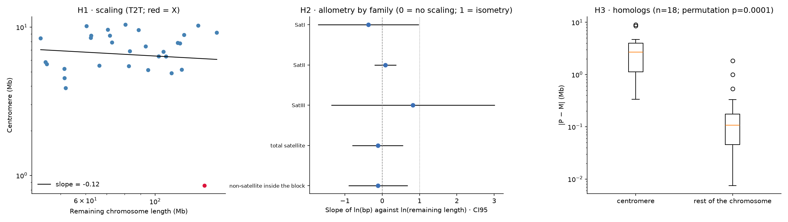

# Centromeric heterochromatin of *Capra hircus*
### A sequence-based case study with public data

How big are goat centromeres, do they scale with chromosome size, what are they made of, and how much do the two haplotypes of one animal differ? This project answers those questions from the **telomere-to-telomere goat genome** (Wu et al. 2024), using only public data, from raw download to statistics.

> **Personal portfolio / practice project.** It is not peer reviewed and it is not a research article. Read the [limitations](#limitations) before interpreting any number. Analysis developed with the assistance of an AI coding assistant (Claude Code); all decisions and results were reviewed by the author.



## At a glance

| | |
|---|---|
| **Data** | T2T-goat2.0 genome and its two haplotypes (2.0P, 2.0M), a male Inner Mongolia Cashmere goat (`IMCG_204112`); PacBio reads of five other breeds |
| **Approach** | Orient chromosomes → discover satellite units (SRF) → annotate → delimit each centromere → statistics |
| **Stack** | Python (pandas, statsmodels, SciPy), minimap2, samtools, KMC, SRF |
| **Runtime** | ~15 min of compute for the whole pipeline (plus downloads of ~5 GB) on an Apple-silicon laptop |
| **Main finding** | Centromere satellite arrays are large, almost independent of chromosome size, and differ strongly between haplotypes |

## Questions and hypotheses

- **H1 – scaling.** Does centromere length scale with chromosome size?
- **H2 – composition.** Does satellite composition (SatI / SatII / SatIII) explain part of the variation?
- **H3 – homologs.** Do the two homologs differ more in the centromere than in the rest of the chromosome?
- *Exploratory:* does the satellite content vary between breeds?

## What was done

1. **Data and assemblies.** Download of the three genomes from NCBI with MD5 checks; standardised chromosome names (`CHI1…CHI29, CHIX, CHIY`); subsampled PacBio reads from ENA.
2. **Satellites and centromeres.**
   - Each chromosome is **oriented** from the SatI signal at both ends (in the deposited sequence most centromeres are at the right end, contrary to what one would assume).
   - **SRF** (k-mer based) finds 21 repeat units; they are classified by sequence into **SatI** (816-bp monomer), **SatII** (702 bp) and **SatIII** (22-bp motif).
   - Units are mapped back to the genome and each **centromere is defined as the satellite block with the most sequence** (an operational definition).
   - The unusual position of the **X chromosome** centromere was checked and explained ([docs](docs/X_CHROMOSOME_CHECK.md)).
3. **Statistics.** Log–log scaling with robust and bootstrap intervals, influence diagnostics and a power analysis (H1); allometry by satellite family and a pairwise log-ratio (H2); paired permutation tests on relative and absolute differences between haplotypes (H3); bootstrap over reads for breeds.

## Key results

All numbers come from `data/results_summary.json` and the tables in `data/`.

- **Centromeres** span 0.85–10.4 Mb (the shortest is the X). SatI adds up to ≈ 117 Mb and SatII to ≈ 26 Mb, matching the totals reported by Wu et al. (118.2 and 26.5 Mb). SatIII (≈ 6 Mb) is under-detected.
- **H1 – no detectable scaling.** Slope of ln(centromere) on ln(remaining chromosome length) = −0.12 (95 % CI −0.80 to 0.57); 0.19 (−0.10 to 0.47) without the X. The analysis could detect, with 80 % power, a slope ≥ 0.39 (without the X) or ≥ 0.66 (with it): a **strong** scaling is ruled out, a weak or moderate one is not. This agrees with the literature on the *functional* centromere, which is rather uniform within a species, and with satellite arrays being unconstrained and highly variable.
- **H2 – weak support.** No satellite family scales with chromosome size. The SatI/SatII log-ratio adds 0.73 of R² to the scaling model, but only 0.25 without the X, and it is partly circular (it describes the same block).
- **H3 – supported.** In 18 autosomes with complete centromeres in both haplotypes, the median absolute difference is **2.7 Mb in the centromere versus 0.11 Mb in the rest of the chromosome** (permutation p ≈ 5×10⁻⁵); it is driven mostly by SatI. It holds on relative and absolute scales, without the outlier (CHI21) and with a strict gap criterion.
- **Breeds (exploratory).** Relative to the reference animal, the SatI/SatII ratio is lower in Tibetan (−1.12, CI −1.32 to −0.92) and Boer (−0.26, CI −0.43 to −0.09) and not different in the other three. Tibetan also has an atypical library (more reads with satellite, longer N50), so a technical explanation cannot be excluded.

## Limitations

- **One animal.** P and M are the two haplotypes of the same individual, not two individuals; differences between them may include assembly artefacts.
- **Operational centromere.** It is the satellite domain, not the functional CENP-A domain, and can be longer than published values. CENP-A ChIP-seq was evaluated and discarded ([why](docs/NOTE_chipseq_removed.Rmd)).
- **SatIII** (22-bp motif) is poorly detected by alignment.
- **Breeds:** PacBio CLR subreads at ~0.17× coverage; genome-wide fractions only.
- **Power.** With n = 29–30 chromosomes, weak scaling cannot be excluded.
- **The X chromosome** is a highly influential point (short centromere in a long chromosome); results are reported with and without it.

## Reproducibility

Three levels, from cheapest to most complete:

1. **Read** the executed notebook: [`notebooks/analysis.ipynb`](notebooks/analysis.ipynb).
2. **Re-run the statistics** (section 3) in seconds, from the tables committed in `data/` — no downloads. The breeds step is skipped if `data/reads/` is absent.
3. **Re-run everything** from the raw public data (downloads ~5 GB; ~15 min of compute; ~13 GB of intermediate files in `work/`).

```bash
# macOS (Apple silicon). External tools via Homebrew:
brew install minimap2 samtools

python3 -m venv .venv && source .venv/bin/activate
pip install -r requirements.txt
python -m ipykernel install --user --name capra --display-name "Capra hircus"

jupyter lab notebooks/analysis.ipynb      # run from the repository root or from notebooks/
# or, headless:  python scripts/run_notebook.py 0 notebooks/analysis.ipynb
```

KMC, SRF and k8 are downloaded and built automatically into `tools/` (macOS arm64 only). The notebook is idempotent: it skips downloads whose MD5 already matches.

## Repository structure

```
├── notebooks/analysis.ipynb      the whole analysis, in three sections, executed
├── data/                         tables produced by the pipeline (raw downloads and reads are git-ignored)
│   └── figures/summary.png
├── docs/
│   ├── X_CHROMOSOME_CHECK.md     evidence on the position of the X centromere
│   ├── NOTE_chipseq_removed.Rmd  why CENP-A ChIP-seq was dropped
│   └── REFERENCES.md
├── scripts/run_notebook.py       headless, cell-by-cell runner with a log
├── requirements.txt  CITATION.cff  LICENSE  LICENSE-CC-BY-4.0.txt
```

## Method notes worth knowing

- **A classification bug was found and fixed.** Units of 132, 770 and 2115 bp had been counted as SatII; they are mostly repeats of the 22-bp SatIII motif. Classifying units by sequence brought the SatII total from ≈ 33 Mb to ≈ 26 Mb, in line with the paper.
- **Orientation is verified, not assumed.** Most chromosomes carry their SatI block on the right end of the deposited sequence.
- **Scale matters for H3.** A 0.5-Mb difference is 10 % of a centromere but 0.4 % of the rest of a chromosome, so differences are compared on both relative and absolute scales.

## License

- **Code:** MIT ([LICENSE](LICENSE)).
- **Text, figures and documentation:** CC BY 4.0 ([LICENSE-CC-BY-4.0.txt](LICENSE-CC-BY-4.0.txt)).
- **Data** are public (NCBI, ENA) and are not redistributed here; the tables in `data/` are derived results.

## Key references

Wu et al. 2024 (*Nat Commun* 15:10041) for the genome; Zhang et al. 2023 (*Genome Res*) for SRF; Plačková et al. 2021 and Zhang & Dawe 2012 for centromere-size scaling; Logsdon et al. 2024/2025 (*Nature*) for variation of centromeric satellite arrays; Greenacre et al. 2022 (*Stat Sci*) for pairwise log-ratios. Full list in [docs/REFERENCES.md](docs/REFERENCES.md).
